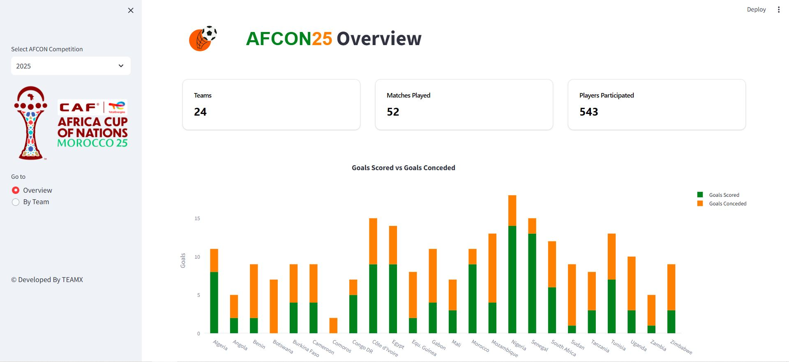

<div align="center">

# ⚽ AFCON Statistics Dashboard (2010–2025)

An interactive Streamlit dashboard for exploring team and player statistics
across nine Africa Cup of Nations editions, from 2010 through 2025.

</div>



## About

Choose an edition—**2010, 2012, 2013, 2015, 2017, 2019, 2021, 2023, or 2025**—
to explore tournament summaries, team performance, and player contributions.
The dashboard opens on **2025**.

## Features

- **Overview:** tournament summary, goals scored and conceded, goal types,
  goal timing when available, possession, shots on target, top contributors,
  clean sheets, fouls, and cards
- **By Team:** squad and player statistics, minutes played, contributions,
  goal types, tackles, cards, and team comparisons
- Interactive tournament and team selectors

## Run locally

```bash
git clone https://github.com/TeamXGroup/AFCON23-Streamlit-Dashboard.git
cd AFCON23-Streamlit-Dashboard
pip install -r requirements.txt
streamlit run app.py
```

## Data

Competition statistics are collected from [FBref](https://fbref.com/en/comps/656/history/Africa-Cup-of-Nations-Seasons).
Supplementary tournament information comes from sources including FootyStats
and RSSSF. Datasets are stored in the repository and loaded locally by the app;
statistics unavailable for an edition are shown as unavailable.

## Project structure

- `app.py` — Streamlit dashboard
- `season_data.py` — tournament data selection and overview helpers
- `Datasets/` — original and supplementary datasets
- `AFCON_Seasons/` — historical tournament datasets
- `AFCON25_Scraping/` — 2025 datasets
